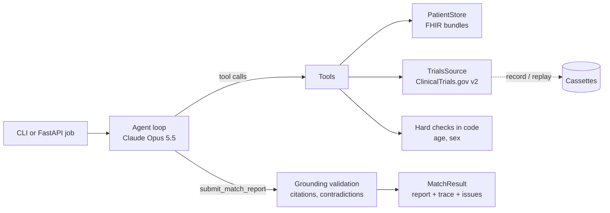

# trialmatch-agent

A Claude agent that reads a patient record (FHIR R4), searches ClinicalTrials.gov for recruiting trials, and returns a ranked shortlist in which **every eligibility criterion is marked met, not met or unknown, with the exact record entries it relied on**. Code, not the model, then checks the parts that can be checked: age and sex limits, and whether every cited record entry actually exists.

It is decision support for a trial coordinator. It does not decide eligibility, and all patient data in this repository is synthetic.

## Why this exists

Screening patients for trials is slow because eligibility criteria are long free text and the evidence is scattered across a record. A useful assistant has to do three things a plain chatbot does not:

1. **Integrate with real systems.** Patient data comes from FHIR, trials from a live public API with rate limits, odd field shapes and Markdown escapes.
2. **Show its work.** A coordinator will only trust a verdict if each criterion points at the lab value or diagnosis behind it.
3. **Be checked by code where possible.** Arithmetic (ages, limits) and citation existence are verified deterministically, and contradictions are flagged rather than hidden.

## Architecture



| Piece | File | Notes |
|---|---|---|
| Contracts | `src/trialmatch/models.py`, `ports.py` | Pydantic types; `PatientStore` and `TrialsSource` protocols so a hospital FHIR server can replace local files |
| Patient store | `patients.py` | FHIR R4 bundles, age computed in code, every item keeps its resource id; also loads Synthea output |
| Trials client | `trials.py` | Retries with backoff, honours `Retry-After`, trims criteria, unescapes Markdown, live / record / replay modes |
| Hard checks | `hard_checks.py` | Age and sex limits, authoritative over the model |
| Agent | `agent.py`, `tools.py`, `prompts.py` | Manual tool loop, strict tool schemas, append-only history, refusal fallback, prompt caching, turn cap |
| Grounding | `grounding.py` | Flags invented evidence ids, unseen trials, and "eligible" verdicts that failed a hard check |
| Eval | `eval.py`, `evals/` | Rule-based metrics, no LLM judge; see `evals/README.md` |
| Service | `api.py`, `cli.py`, `config.py` | Async job API, CLI, structured logs without patient data |
| Ops | `Dockerfile`, `docker-compose.yml`, `.github/workflows/ci.yml` | CI runs fully offline with recorded API responses |

The agent has five tools: `get_patient_summary`, `get_lab_results`, `search_trials`, `get_trial_eligibility` (returns the criteria plus the code hard-check result) and `submit_match_report` (validated against the report schema; invalid reports go back to the model as errors to fix). The run is scoped to one patient, so the model cannot read other records.

Design decisions and trade-offs are written up in [docs/design.md](docs/design.md).

## Quick start

Requires Python 3.10+ and an Anthropic API key.

```bash
python -m venv .venv
source .venv/bin/activate          # Windows: .venv\Scripts\activate
pip install -e ".[dev]"

# Offline: tests use recorded ClinicalTrials.gov responses and a fake Claude client
TRIALMATCH_HTTP=replay pytest      # PowerShell: $env:TRIALMATCH_HTTP="replay"; pytest

# Live
export ANTHROPIC_API_KEY=sk-ant-...   # PowerShell: $env:ANTHROPIC_API_KEY="sk-ant-..."
trialmatch patients
trialmatch match --patient p001 --country Netherlands
```

### Run it locally with no API key (Ollama)

The agent talks to models through a small provider interface (`src/trialmatch/llm.py`). Claude is the reference provider; a local open-weights model through [Ollama](https://ollama.com) also works, at no cost and with no data leaving the machine (the on-premises setup many hospitals require).

```bash
# install Ollama, then:
ollama pull qwen3:8b                  # about 5 GB; qwen3:4b for smaller GPUs
trialmatch match --patient p004 --provider ollama
python -m trialmatch.eval --patients all --provider ollama --yes
```

Small local models are much weaker at long tool-use runs, so local runs assess at most 4 trials and are expected to trip the code checks more often. The same checks apply to every provider; that is the point of them.

### Service

```bash
trialmatch serve --port 8000          # docs at http://127.0.0.1:8000/docs
curl -X POST localhost:8000/matches -H "Content-Type: application/json" -d '{"patient_id":"p004"}'
curl localhost:8000/matches/<run_id>
```

A run takes minutes, so `POST /matches` returns a job id (202) and `GET /matches/{run_id}` returns the status and, when done, the full result with its trace and grounding issues. Set `TRIALMATCH_API_TOKEN` to require `Authorization: Bearer <token>`; the queue is capped by `TRIALMATCH_MAX_QUEUED_RUNS` (429 when full).

A result is `completed` only if code checks found nothing wrong. When the agent submits a report, the checks run immediately and any problems (an invented citation, a verdict that contradicts its own criteria, a non-recruiting trial, "likely eligible" on truncated criteria) go back to the model to fix. If they remain after two attempts, the status is `completed_with_issues` and the CLI exits with code 3: a person needs to review it.

### Docker

```bash
docker compose up --build             # passes ANTHROPIC_API_KEY through from your shell
```

## Synthetic patients

Eight hand-written FHIR bundles in `data/patients/`, four with planted problems the agent should catch:

| Patient | Profile | Planted issue |
|---|---|---|
| p001 | 56 F, type 2 diabetes | none |
| p002 | 68 M, type 2 diabetes, CKD stage 4 | eGFR about 24 |
| p003 | 47 F, HER2-positive breast cancer | prior chemotherapy |
| p004 | 34 F, breast cancer | currently pregnant |
| p005 | 72 M, COPD | none |
| p006 | 81 M, heart failure | age above common limits |
| p007 | 17 F, asthma | under 18 |
| p008 | 52 F, rheumatoid arthritis | none |

## Evaluation

```bash
python -m trialmatch.eval --patients all --http live --effort high
```

Metrics: run health, hard-constraint violations (target 0), citation validity (target 100%), criterion coverage, planted-disqualifier recall, and cost, latency and tool calls per patient. Results go to `evals/results/<timestamp>/`.

**Results:** pending the first live run.

## Limitations

- Synthetic data only, eight patients, one run each. Not validated on real records.
- Only age and sex are checked in code. Everything else (lab thresholds, prior therapy, pregnancy) is the model's reading, checked only for citation existence and by the planted-issue eval.
- Citation validity proves an entry exists, not that it supports the claim.
- Live trials change daily, so live runs are not reproducible; use `record` then `replay` to pin one.
- The job store is in memory and per process.
- Cost estimates use Opus 5.5 prices for every turn, even turns served by the fallback model.
- Trial criteria text is untrusted input. The model is told to treat it as data, and the search query is restricted to a short condition name, but prompt injection is reduced, not ruled out.
- Not a medical device. Output is a starting point for a human coordinator.
